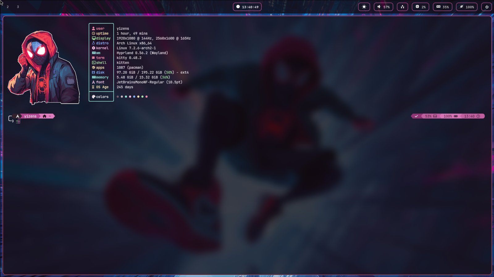
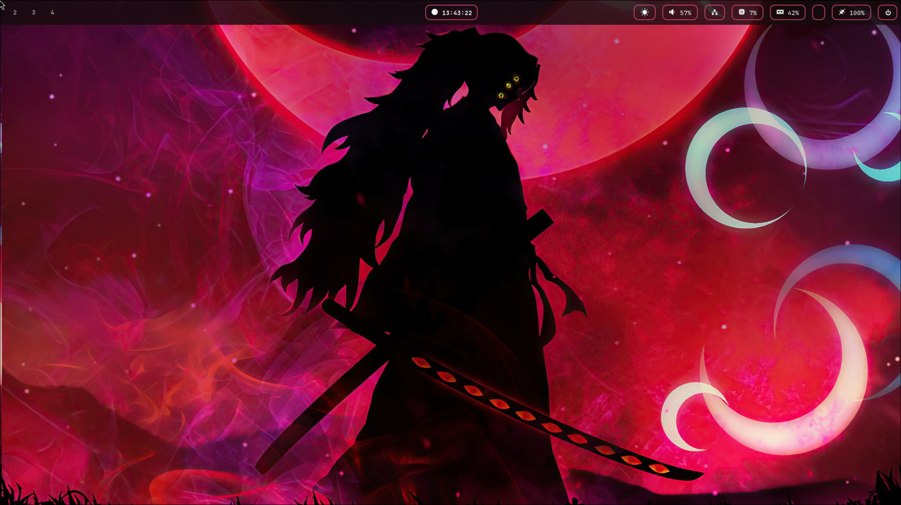
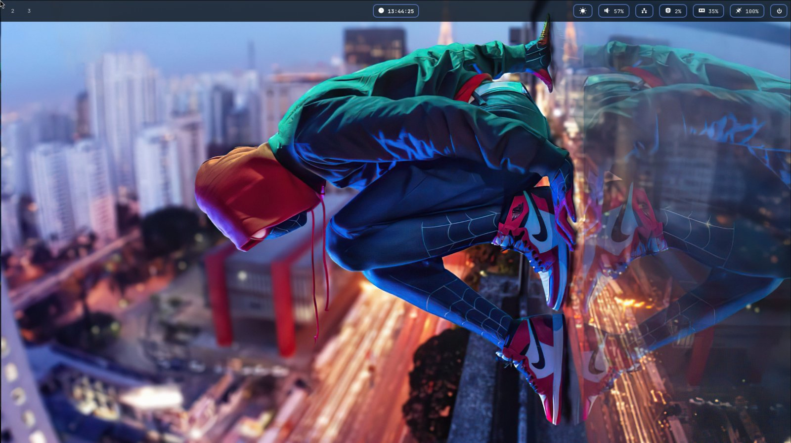
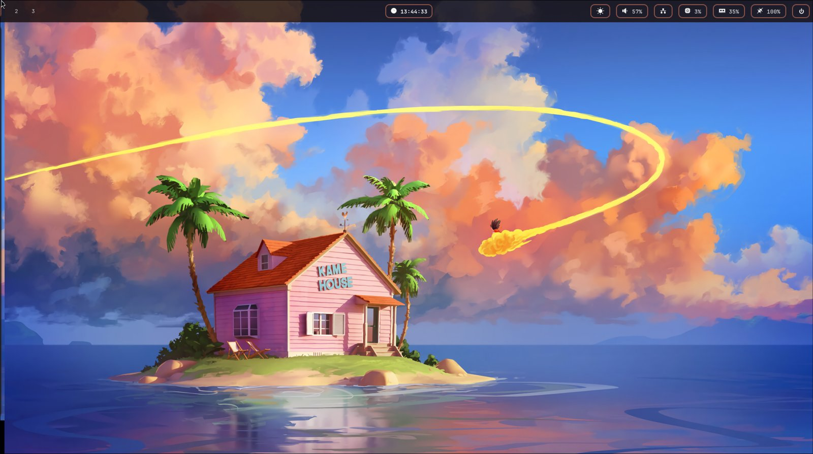
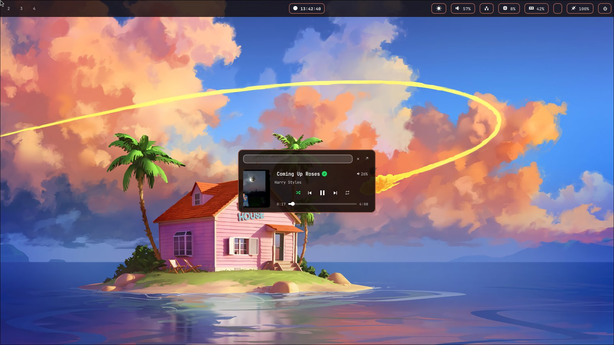
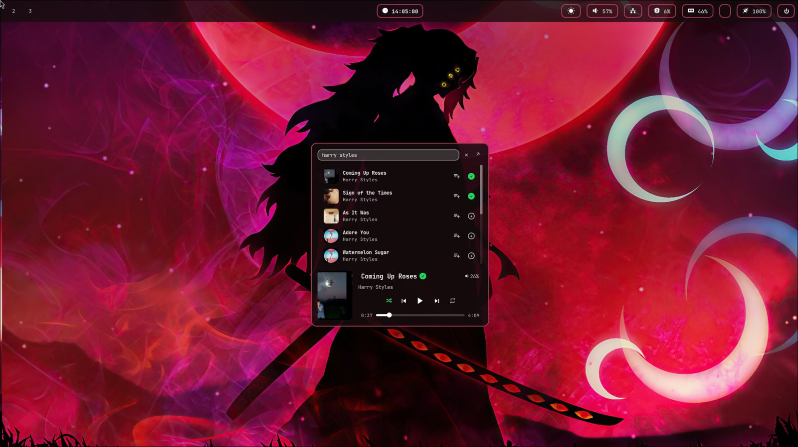
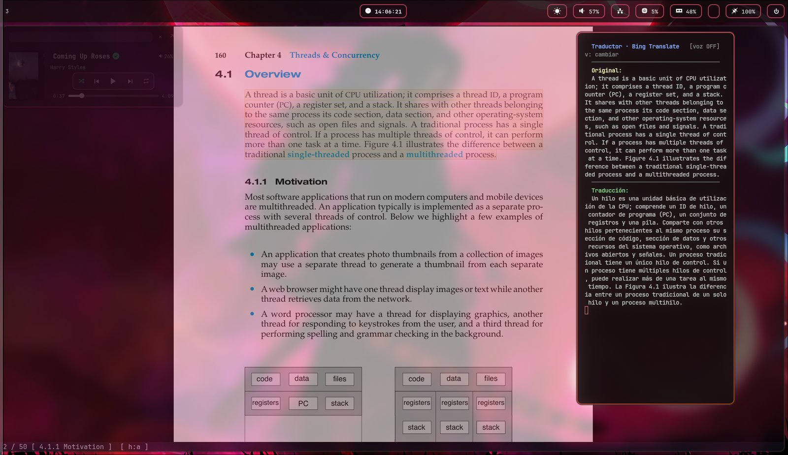
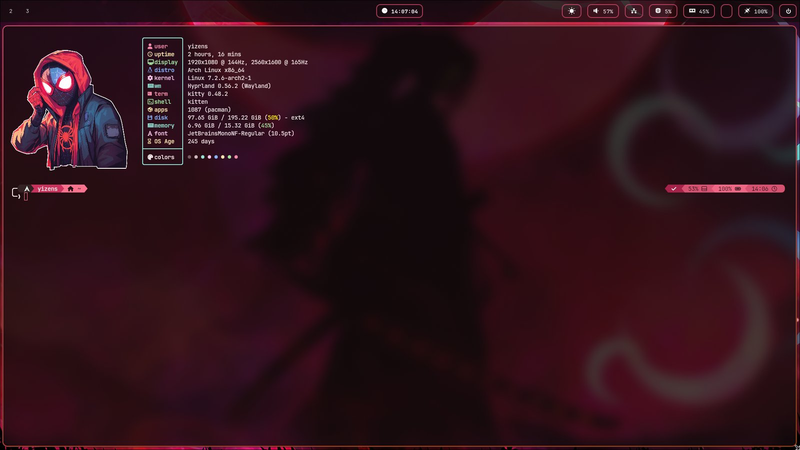
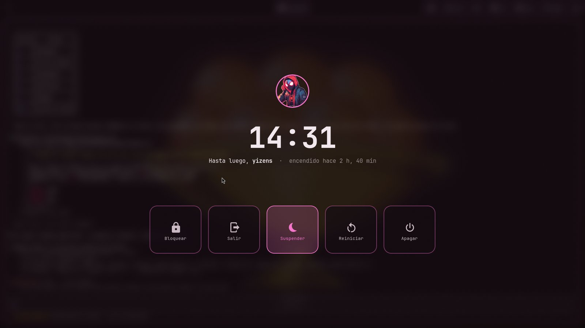
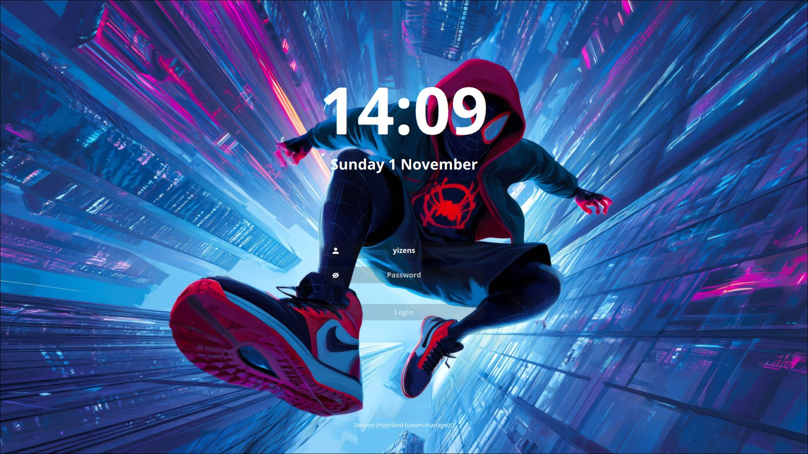

<div align="center">

# yizens · dotfiles

**An Arch Linux + Hyprland desktop whose colors follow the wallpaper.**

Every element — bar, borders, notifications, terminal, launcher, widgets and
shell prompt — is re-themed from the current wallpaper in under a second, with
a custom palette engine that keeps any image looking balanced.




</div>

---

## Contents

- [Highlights](#highlights)
- [Gallery](#gallery)
- [Custom tools](#custom-tools)
- [Software](#software)
- [Installation](#installation)
- [Keybindings](#keybindings)
- [Repository layout](#repository-layout)
- [Customization](#customization)
- [Maintenance](#maintenance)
- [Troubleshooting](#troubleshooting)

---

## Highlights

- **Wallpaper-driven theming** — switch wallpaper with a single key and the
  whole desktop adapts: Waybar, window borders, dunst, kitty, rofi, eww and the
  powerlevel10k prompt (open terminals update on the next command).
- **Perceptual palette engine** — colors are built in OKLCH with chroma limits,
  so neon wallpapers don't produce garish UIs and dull ones don't look washed out.
- **Animated wallpaper transitions** with awww, and a live-reloading Waybar
  (no restart, colors fade in).
- **Spotify widget** with search, queue, likes and keyboard navigation.
- **Live PDF translator** for sioyek with optional neural voice.
- **Power menu** with three interchangeable designs, all themed from the wallpaper.
- **Quality-of-life daemons**: Windows-style autoscroll, automatic Bluetooth
  audio routing, Wi-Fi off when Ethernet is plugged in, night light.
- **Safe, idempotent installer** with dry-run, hardware detection, automatic
  backups and a pre-commit secret scanner.

---

## Gallery

### The palette follows the wallpaper

| | |
|:-:|:-:|
|  |  |
| *Saturated red → softened rose accents* | *Almost-black image → subtle crimson* |
|  |  |
| *Cool blues → periwinkle accents* | *Mixed tones → cool, balanced palette* |
|  |  |
| *Warm sunset → peach accents* | *Animated transition* |

### Apps and widgets

| | |
|:-:|:-:|
|  |  |
| *Spotify player (`Super + N`)* | *Search, queue and like from the widget* |
|  |  |
| *Live translator next to a PDF* | *kitty + zsh + powerlevel10k* |

|  |  |
|:-:|:-:|
| *Power menu (`Super + P`)* | *SDDM login (astronaut theme)* |

---

## Custom tools

Everything in this section was written for this setup.

### 🎨 Dynamic theme engine
`~/.config/hypr/theme.sh` · `~/.config/matugen/palette.py`

```
wallpaper ──► palette.py ──► palette.json ──► matugen templates ──► every app
              (OKLCH)                         (7 templates)         reloads
```

1. **matugen** picks the wallpaper's accent color; only its **hue** is kept.
2. **`palette.py`** rebuilds the full palette in **OKLCH** (a perceptual color
   space) using fixed lightness levels per role — accent, borders, surfaces,
   text — so every wallpaper produces colors of the same visual weight.
3. Guard rails keep it tasteful on *any* image:

   | Wallpaper | Rule |
   |---|---|
   | Very saturated (neon, pure red) | Chroma is **capped** |
   | Dull or pastel | Chroma has a **floor** (never above the source) |
   | Grayscale / almost no color | Falls back to an elegant **monochrome** theme |
   | Yellow / yellow-green hues | Extra lightness (they turn muddy when dark) |
   | Mostly neutral with a small colored detail | The detail sets the hue — like a designer would |

4. The secondary color is an **analogous** hue (±35°) so gradients harmonize.
5. Prompt segments pick dark or white text by **WCAG contrast**.
6. matugen renders the templates; Waybar hot-reloads its CSS (with a 1.2 s color
   fade), dunst/Hyprland/kitty are reloaded, and zsh re-reads the palette on the
   next prompt.

Tune the look at the top of `palette.py` (`CHROMA_MAX`, `HUE2_SHIFT`, …).

### 🎵 Spotify widget (eww)
`~/.config/eww/`

- **Hover popup**: hovering the Spotify icon in Waybar opens a mini player;
  moving away closes it.
- **Centered player** (`Super + N`) on the monitor under the cursor; launches
  Spotify silently in a special workspace if it isn't running.
- **Search** the Spotify catalog as you type, **play** a result, **add it to
  the queue**, or **like / unlike** it (Liked Songs).
- Play/pause, previous/next, shuffle, repeat, seek bar and volume.
- **Keyboard navigation** between results, volume and playback rows.

Uses the Spotify Web API — see [Spotify widget setup](#spotify-widget-setup).

### 📖 Live translator for sioyek
`~/.local/bin/sioyek-translate-watch.sh`

Read English PDFs with a Spanish translation beside them.

- Press `Super + T` to open the translator panel next to sioyek.
- **Select any text** in the PDF: it is translated EN → ES instantly
  (Bing via `translate-shell`), with debounce and an on-disk cache.
- **Neural voice** (optional): reads the translation sentence by sentence with
  Microsoft Edge TTS (`es-AR-ElenaNeural`). Toggle with `v` in the panel or
  `Super + V` anywhere.
- `sioyek-translate.sh`: alternative that translates the clipboard with
  **Claude** and shows the result in a dialog.

### ⏻ Power menu
`~/.config/waybar/power/`

Opened with `Super + P` or the ⏻ button in Waybar. Three designs share the same
actions, keys and confirmation dialog — switch with
`~/.config/waybar/power_menu.sh --set <design>`:

| Design | Look |
|---|---|
| `full` *(default)* | Fullscreen blurred veil, round avatar with an accent ring, big clock, greeting and glass cards |
| `icons` | Compact floating glass pill with large icons |
| `panel` | eww side panel that slides in from the right with avatar, uptime and battery |

- Keys: `L` lock · `E` log out · `S` suspend · `R` reboot · `P` power off · `Esc` close.
- Log out, reboot and power off ask for **confirmation** ("No" preselected);
  *Suspend* is preselected so a stray `Enter` never shuts anything down.
- The avatar comes from `~/.face` (falls back to the fastfetch logo) and is
  cropped to a circle by `avatar.py`.
- **hyprlock** lock screen with the same dynamic colors.

### 🖱️ Windows-style autoscroll
`~/.local/bin/autoscroll` · user service

Hold the **middle mouse button and drag** to scroll any window, faster the
further you move (with acceleration and a dead zone). A short middle click
still pastes / opens links as usual. Implemented with `evdev` + a virtual
`uinput` device, so it works in every Wayland app.

### 🔊 Automatic audio routing
`~/.local/bin/auto-audio-route` · user service

When Bluetooth headphones connect, they become the default output and
**currently playing streams move to them**; when they disconnect, audio falls
back to the internal speakers.

### 🌐 Wired over Wi-Fi
`~/.local/bin/wired-over-wifi` · user service

Turns Wi-Fi **off while Ethernet is connected** and back on when it's unplugged.

### 🌙 Night light
`~/.local/bin/night-light-toggle.sh`

Warm screen filter via `hyprsunset`, toggled with `Super + F7` or by clicking
its Waybar module (which shows the current state).

### 🖼️ Wallpaper switcher
`~/.config/hypr/wallpaper.sh`

Next / random wallpaper from `~/Wallpapers` with an animated **awww**
transition, a notification with the file name, and the palette regenerated —
the choice is remembered across reboots.

---

## Software

Packages are split into groups; the installer asks which ones you want.
`aur:` marks AUR packages.

<details open>
<summary><b>Desktop (base)</b> — always installed</summary>

| Role | Software |
|---|---|
| Compositor | Hyprland (Lua config), xdg-desktop-portal-hyprland, uwsm |
| Login / lock | SDDM + `sddm-astronaut-theme`, hyprlock |
| Bar / widgets | Waybar, eww |
| Notifications | dunst |
| Launcher | rofi |
| Wallpaper | awww, waypaper |
| Theming | matugen + custom palette engine |
| Terminal / shell | kitty, zsh, oh-my-zsh, powerlevel10k |
| Files | Dolphin, yazi, Ark |
| Audio | PipeWire, WirePlumber |
| Network | NetworkManager, Bluetooth (bluez, blueman) |
| Fonts | JetBrainsMono Nerd, Iosevka Nerd, Font Awesome |
| Utilities | grim, slurp, wl-clipboard, brightnessctl, playerctl, hyprsunset, fastfetch, htop, neovim |

</details>

<details>
<summary><b>Apps</b></summary>

| Category | Software |
|---|---|
| Browsers | Firefox, Google Chrome, Brave, Microsoft Edge |
| Media | Spotify (+ Spicetify), mpv, OBS Studio, Snapshot |
| Communication | Discord |
| Documents | LibreOffice, WPS Office, Okular, sioyek |
| Notes / drawing | Xournal++, Rnote, Krita |
| Other | ImageMagick, espeak-ng, zenity |

</details>

<details>
<summary><b>Development</b></summary>

| Category | Software |
|---|---|
| Editors | Visual Studio Code, Neovim (LazyVim), Zed *(optional)* |
| Languages | Node.js / npm, Python + uv, R + RStudio |
| Databases | PostgreSQL, DBeaver |
| Modeling | StarUML, Visual Paradigm |
| Tools | git-filter-repo, strace, android-tools, gnuplot, graphviz |
| AI | Claude Code *(optional)* |

</details>

<details>
<summary><b>Optional groups</b></summary>

| Group | Contents |
|---|---|
| `nvidia` | `nvidia-open-dkms`, VA-API driver — offered only if an NVIDIA GPU is detected |
| `latex` | Full TeX Live + TeXstudio (~3 GB) |
| `printing` | CUPS, printer drivers, scanner support |
| `hardware` | DroidCam (phone as webcam), OpenTabletDriver |

</details>

---

## Installation

> **Requirements:** a fresh Arch Linux install (e.g. via `archinstall`), a user
> with `sudo`, an internet connection and `git`.

```bash
git clone https://github.com/Angel-Cs2004/dotfiles.git ~/dotfiles
cd ~/dotfiles
./install.sh --dry-run   # preview every action, changes nothing
./install.sh             # install
```

Reboot when it finishes. A full install takes ~15–40 minutes (AUR packages are
compiled).

### What the installer does

1. **Pre-flight checks** — Arch only, not root, internet available.
2. **System upgrade** (`pacman -Syu`) and **yay** bootstrap.
3. **Hardware detection** — Intel/AMD microcode, NVIDIA GPU.
4. **Packages** for the selected groups. Each package is verified first; a
   failure is reported at the end instead of aborting the run.
5. **Links the configuration** into `$HOME`. Anything already there is
   **moved to `~/.dotfiles-backup/<timestamp>/`** — nothing is ever deleted.
6. **System setup** — SDDM theme, services (SDDM, NetworkManager, Bluetooth),
   `input` group, zsh as login shell, oh-my-zsh and plugins.
7. **Generates the color palette** from the wallpaper.
8. **Self-check** of links, dependencies, Hyprland version and palette.

Every run is logged to `~/.local/state/dotfiles/install-<timestamp>.log`.

### Options

| Command | Description |
|---|---|
| `./install.sh` | Full interactive install |
| `./install.sh --yes` | Accept defaults, no prompts |
| `./install.sh --dry-run` | Print what would happen, change nothing |
| `./install.sh --only-config` | Only link the configuration (no packages, no sudo) |
| `./install.sh --check` | Verify links, dependencies, Hyprland version and palette |

The installer is **idempotent**: run it as many times as you like.

### Spotify widget setup

The widget needs your own Spotify API app (free):

1. Create an app at <https://developer.spotify.com/dashboard> with redirect URI
   `http://127.0.0.1:8888/callback`.
2. Save its keys in `~/.config/eww/spotify_credentials` (never committed):
   ```ini
   CLIENT_ID=<your-client-id>
   CLIENT_SECRET=<your-client-secret>
   ```
3. Run once to authorize likes and queue: `python3 ~/.config/eww/scripts/auth.py`

---

## Keybindings

`Super` is the Windows key.

<details open>
<summary><b>Apps & windows</b></summary>

| Keys | Action |
|---|---|
| `Super + D` | App launcher (rofi) |
| `Super + R` | Run a command |
| `Alt + Tab` | Terminal (kitty) |
| `Super + B` | Browser |
| `Super + E` | File manager (yazi) |
| `Super + Q` | Close window |
| `Super + Tab` | Fullscreen |
| `Super + J` | Toggle split direction |
| `Super + ←↑→↓` | Move focus |
| `Ctrl + left drag` / `right drag` | Move / resize window |

</details>

<details open>
<summary><b>Workspaces</b></summary>

| Keys | Action |
|---|---|
| `Super + 1…0` | Go to workspace |
| `Super + Shift + 1…0` | Move window to workspace |
| `Super + scroll` | Next / previous workspace |
| `Super + S` | Toggle scratchpad |
| `Super + Shift + S` | Send window to scratchpad |

</details>

<details open>
<summary><b>Desktop features</b></summary>

| Keys | Action |
|---|---|
| `Super + W` | Next wallpaper (re-themes everything) |
| `Super + Shift + W` | Random wallpaper |
| `Super + Alt + W` | Pick a wallpaper (waypaper) |
| `Super + N` | Spotify player |
| `Super + T` | sioyek translator panel |
| `Super + V` | Toggle translator voice |
| `Super + F7` | Night light |
| `Super + P` | Power menu (`L` lock · `E` log out · `S` suspend · `R` reboot · `P` power off) |
| `Super + M` | Log out |
| `Super + Space` | Switch keyboard layout (latam / us) |
| `Print` | Screenshot of a region → clipboard + `~/Pictures/screenshots` |
| `Super + F5` / `F6` | Brightness down / up |
| Media keys | Volume, brightness, play/pause, next/previous |

</details>

---

## Repository layout

```
dotfiles/
├── install.sh                 installer
├── packages/                  package lists per group + extras.sh (non-pacman tools)
├── home/                      mirrored into $HOME as symlinks
│   ├── .zshrc · .p10k.zsh
│   ├── .config/
│   │   ├── hypr/              Hyprland (Lua), theme.sh, wallpaper.sh, hosts/
│   │   ├── matugen/           palette.py + color templates
│   │   ├── waybar/ eww/ rofi/ kitty/ waypaper/ fastfetch/ yazi/ nvim/ sioyek/ htop/
│   │   └── systemd/user/      autoscroll, audio routing, wired-over-wifi…
│   └── .local/bin/            custom scripts
├── system/                    files for /etc and /usr (SDDM theme)
├── wallpapers/                copied to ~/Wallpapers
├── scripts/                   check-deps.sh · check-secrets.sh
├── docs/                      screenshots
└── .githooks/pre-commit       blocks commits containing secrets
```

Configuration is **symlinked, not copied**: editing `~/.config/hypr/…` edits
the repository directly.

---

## Customization

### Monitors (per machine)

Each computer gets its own file in `home/.config/hypr/hosts/<hostname>.lua`.
Without one, every display uses its native resolution automatically.

```bash
hostnamectl hostname        # this machine's name
hyprctl monitors            # outputs and modes
cp ~/.config/hypr/hosts/archlinux.lua ~/.config/hypr/hosts/$(hostnamectl hostname).lua
```

> Give each machine a **unique hostname** (`sudo hostnamectl hostname my-pc`),
> otherwise they share the same monitor file.

### Colors

| Want | Edit |
|---|---|
| More / less vivid | `CHROMA_MAX` in `home/.config/matugen/palette.py` |
| Contrasting second color | `HUE2_SHIFT = 180` (default `35`, analogous) |
| Change how an app is themed | its template in `home/.config/matugen/templates/` |
| Regenerate without changing wallpaper | `~/.config/hypr/theme.sh` |

Generated color files (`colors.css`, `colors.lua`, `dunstrc`, …) are **not
tracked** — each machine builds its own.

### Wallpaper transition

In `~/.config/waypaper/config.ini`: `swww_transition_type` (`grow`, `wave`,
`wipe`, `outer`, `fade`, `any`), `swww_transition_duration`,
`swww_transition_angle`.

### Adding another app's config

```bash
mv ~/.config/APP ~/dotfiles/home/.config/
echo '!/home/.config/APP/' >> ~/dotfiles/.gitignore   # .gitignore is an allowlist
~/dotfiles/install.sh --only-config
```

---

## Maintenance

```bash
cd ~/dotfiles
git add -A && git commit -m "describe the change" && git push
```

- The **pre-commit hook** blocks commits containing tokens, private keys,
  browser data, PDFs or files over 20 MB. Full scan: `scripts/check-secrets.sh`.
- `.gitignore` is an **allowlist**: nothing is tracked unless explicitly listed.
- `scripts/check-deps.sh` verifies every command, Python module and font the
  configuration relies on.

### Rolling back

Everything the installer replaced lives in `~/.dotfiles-backup/<timestamp>/`,
mirroring your home directory:

```bash
rm ~/.config/APP
mv ~/.dotfiles-backup/<timestamp>/.config/APP ~/.config/
```

---

## Troubleshooting

| Symptom | Fix |
|---|---|
| Bar missing | `~/.config/hypr/theme.sh && ~/.config/hypr/start.sh`; debug with `waybar -l debug` |
| Black screen with NVIDIA | From a TTY (`Ctrl+Alt+F2`): `lsmod \| grep nvidia`; make sure `linux-headers` is installed |
| Boxes instead of icons | Missing fonts — `./install.sh --check` names them |
| Hyprland config errors | `hyprctl configerrors`; the Lua config needs Hyprland ≥ 0.56 |
| An AUR package failed | `yay -S <package>`; the rest of the install is unaffected |
| What did the installer change? | Logs in `~/.local/state/dotfiles/` |

### Not included on purpose

- **Secrets** — Spotify API keys, tokens, `~/.git-credentials`.
- **Browser, Discord and VS Code profiles** — they hold sessions and personal
  data; use each app's own sync.
- **`~/.gitconfig`** — set `user.name` / `user.email` on each machine.
- **sioyek-pastel** — a custom build in `~/.local/opt/sioyek-pastel`; without
  it only yazi's "Open with Sioyek Pastel" entry is unavailable.
- **PostgreSQL data** — installed with the *dev* group, initialized manually
  ([Arch Wiki](https://wiki.archlinux.org/title/PostgreSQL)).

---

<div align="center">
<sub>Made with too many hours of tweaking · Arch Linux · Hyprland</sub>
</div>
