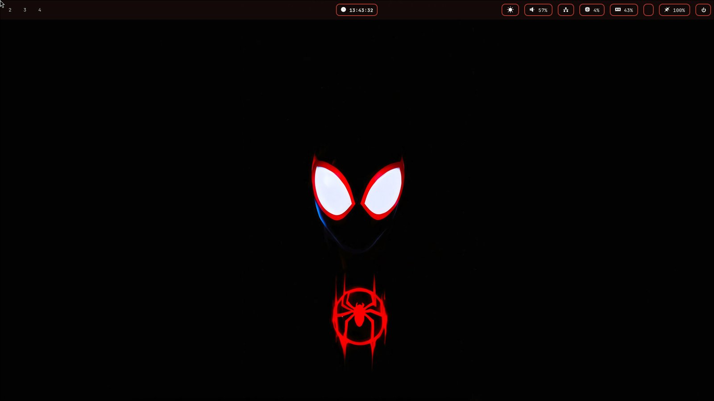
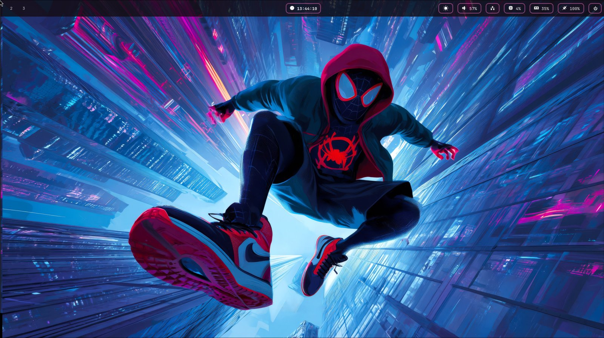

# dotfiles · Arch Linux + Hyprland

Mi escritorio completo en un solo repo: configuración, programas y un instalador
que deja una PC recién instalada igual que la mía.


### Los colores siguen al fondo

Cada vez que cambias el fondo, la barra, los bordes, las notificaciones, la
terminal y el prompt toman su paleta. Fíjate en los bordes de la barra:

| | |
|---|---|
|  |  |
|  |  |
|  |  |

## Qué incluye

| | |
|---|---|
| **Escritorio** | Hyprland (configuración en Lua), SDDM con el tema *astronaut* |
| **Barra** | Waybar con módulos en píldora, recarga de estilos en vivo |
| **Colores dinámicos** | Al cambiar el fondo, **toda** la paleta se adapta: barra, notificaciones, bordes de ventanas, terminal, rofi, eww y el prompt de zsh. La paleta se calcula en OKLCH para que cualquier fondo dé colores equilibrados (ni chillones ni apagados) |
| **Fondos** | awww con transición animada; waypaper para elegir con vista previa |
| **Notificaciones** | dunst, entran deslizándose y combinan con la barra |
| **Terminal** | kitty + zsh + oh-my-zsh + powerlevel10k |
| **Widgets** | eww: reproductor de Spotify y panel |
| **Extras** | luz nocturna, autoscroll, cambio automático de salida de audio, traductor con voz para sioyek |

## Instalación

> **Requisitos:** Arch Linux ya instalado (por ejemplo con `archinstall`), tu
> usuario con `sudo`, conexión a internet y `git`
> (`sudo pacman -S git` si no lo tienes).

```bash
git clone https://github.com/Angel-Cs2004/dotfiles.git ~/dotfiles
cd ~/dotfiles
./install.sh --dry-run   # opcional: muestra todo lo que haría, sin tocar nada
./install.sh
```

El instalador pregunta qué grupos de programas quieres y al final se reinicia
el equipo. Tarda entre 15 y 40 minutos según la conexión (los paquetes de AUR
se compilan).

### Qué hace `install.sh`, paso a paso

1. **Comprueba** que sea Arch, que no se ejecute como root y que haya internet.
2. **Actualiza el sistema** (`pacman -Syu`) e instala **yay** si falta.
3. **Detecta el hardware**: microcódigo Intel/AMD y GPU NVIDIA.
4. **Instala los paquetes** de los grupos que elijas. Antes verifica que cada
   paquete exista; si uno falla, sigue con los demás y te lo dice al final.
5. **Enlaza la configuración** desde el repo a tu carpeta personal. Si ya había
   algo, lo **mueve a `~/.dotfiles-backup/<fecha>/`** (nunca borra nada).
6. **Configura el sistema**: tema de SDDM, servicios (sddm, NetworkManager,
   bluetooth), grupo `input`, zsh como shell, oh-my-zsh y plugins.
7. **Genera la paleta de colores** a partir del fondo.
8. **Revisa** que todo quedó bien (`--check`).

Todo queda registrado en `~/.local/state/dotfiles/install-<fecha>.log`.

### Opciones

| Comando | Para qué |
|---|---|
| `./install.sh` | Instalación completa, preguntando |
| `./install.sh --yes` | Igual, aceptando las opciones por defecto |
| `./install.sh --dry-run` | Muestra lo que haría, sin cambiar nada |
| `./install.sh --only-config` | Solo enlaza la configuración (sin paquetes ni sudo) |
| `./install.sh --check` | Revisa enlaces, dependencias, versión de Hyprland y colores |

Se puede ejecutar las veces que quieras: lo que ya está hecho se salta.

### Grupos de programas

| Grupo | Archivo | Por defecto | Contenido |
|---|---|---|---|
| base | `packages/base.txt` | siempre | Hyprland, waybar, dunst, eww, kitty, rofi, matugen, awww, audio, red, fuentes |
| nvidia | `packages/nvidia.txt` | sí, si hay GPU NVIDIA | drivers `nvidia-open` |
| apps | `packages/apps.txt` | sí | navegadores, Spotify, Discord, OBS, LibreOffice, WPS, sioyek… |
| dev | `packages/dev.txt` | sí | VS Code, Node, uv, R/RStudio, DBeaver, PostgreSQL, StarUML… |
| latex | `packages/latex.txt` | no | TeX Live completo + TeXstudio (~3 GB) |
| printing | `packages/printing.txt` | no | CUPS, drivers de impresora, escáner |
| hardware | `packages/hardware.txt` | no | DroidCam, OpenTabletDriver |

En las listas, `aur:` delante del nombre indica un paquete de AUR. Para agregar
un programa, escribe su nombre en la lista que corresponda.

## Atajos de teclado

| Atajo | Acción |
|---|---|
| `SUPER + D` | Menú de aplicaciones |
| `SUPER + R` | Ejecutar un comando |
| `SUPER + Q` | Cerrar ventana |
| `SUPER + TAB` | Pantalla completa |
| `ALT + TAB` | Terminal |
| `SUPER + B` | Navegador |
| `SUPER + E` | Archivos (yazi) |
| `SUPER + W` | Siguiente fondo (cambia también los colores) |
| `SUPER + SHIFT + W` | Fondo al azar |
| `SUPER + ALT + W` | Elegir fondo con waypaper |
| `SUPER + P` | Menú de apagado |
| `SUPER + N` | Panel de eww |
| `SUPER + F5` / `F6` | Bajar / subir brillo |
| `SUPER + F7` | Luz nocturna |
| `SUPER + SPACE` | Cambiar distribución de teclado (latam / us) |
| `SUPER + T` | Traductor de sioyek |
| `Impr Pant` | Captura de una región (se copia y se guarda en `~/Pictures/screenshots`) |

## Estructura del repo

```
dotfiles/
├── install.sh              instalador
├── packages/               listas de programas por grupo + extras.sh
├── home/                   se enlaza en ~  (home/.config/hypr → ~/.config/hypr, etc.)
│   ├── .zshrc  .p10k.zsh
│   ├── .config/            hypr, waybar, eww, rofi, kitty, matugen, waypaper, nvim, yazi…
│   └── .local/bin/         scripts propios
├── system/                 archivos para /etc y /usr (tema de SDDM)
├── wallpapers/             fondos (se copian a ~/Wallpapers)
├── scripts/                check-deps.sh y check-secrets.sh
└── .githooks/pre-commit    bloquea commits con secretos
```

La configuración está **enlazada**, no copiada: al editar `~/.config/hypr/...`
estás editando el repo. Por eso guardar cambios es solo hacer commit.

## Guardar cambios en el repo

```bash
cd ~/dotfiles
git add -A
git commit -m "Describe el cambio"
git push
```

El hook `pre-commit` revisa cada commit y lo **bloquea** si detecta tokens,
contraseñas, cookies, PDFs o archivos enormes. Para revisar todo el repo a mano:
`scripts/check-secrets.sh`.

### Agregar la configuración de otra app

1. Mueve su carpeta al repo: `mv ~/.config/APP ~/dotfiles/home/.config/`
2. Permítela en `.gitignore` agregando la línea `!/home/.config/APP/`
3. Ejecuta `./install.sh --only-config` para crear el enlace.

## Usarlo en otra PC

**Monitores.** Cada PC tiene su archivo en `home/.config/hypr/hosts/<hostname>.lua`.
Si no existe, Hyprland usa la resolución nativa de cada pantalla. Para crear el tuyo:

```bash
hostnamectl hostname            # nombre de esta PC
hyprctl monitors                # nombres y resoluciones de tus pantallas
cp ~/.config/hypr/hosts/archlinux.lua ~/.config/hypr/hosts/$(hostnamectl hostname).lua
```

y edítalo. **Ponle a cada PC un nombre distinto**
(`sudo hostnamectl hostname mi-pc`); si dos PCs se llaman `archlinux`
compartirán el mismo archivo de monitores.

**Usuario distinto.** Las rutas usan `~` y `$HOME`, así que funciona con cualquier
nombre de usuario. Única excepción: el comando del traductor en
`home/.config/sioyek/prefs_user.config`, porque sioyek no expande variables.

## Colores dinámicos

El flujo al cambiar el fondo:

```
waypaper → ~/.config/hypr/theme.sh
            ├─ matugen/palette.py   calcula la paleta (OKLCH) → ~/.cache/theme/palette.json
            ├─ matugen              rellena las plantillas de matugen/templates/
            └─ recarga dunst, Hyprland y kitty (waybar se recarga sola)
```

- Para regenerar los colores sin cambiar de fondo: `~/.config/hypr/theme.sh`
- Para ajustar el gusto, al inicio de `home/.config/matugen/palette.py`:
  `CHROMA_MAX` (más o menos vivo) y `HUE2_SHIFT` (distancia al segundo color).
- Los archivos de colores generados (`colors.css`, `colors.lua`, `dunstrc`…) **no
  se versionan**: se crean en cada PC.

## Deshacer

Todo lo que el instalador reemplazó está en `~/.dotfiles-backup/<fecha>/`, con
la misma estructura que tu carpeta personal. Para volver a la versión anterior
de una app:

```bash
rm ~/.config/APP
mv ~/.dotfiles-backup/<fecha>/.config/APP ~/.config/
```

## Problemas comunes

| Síntoma | Solución |
|---|---|
| La barra no aparece | `~/.config/hypr/theme.sh && ~/.config/hypr/start.sh`. Si sigue igual: `waybar -l debug` |
| Pantalla negra al entrar con NVIDIA | Desde otra TTY (`Ctrl+Alt+F2`): verifica que el módulo cargó (`lsmod \| grep nvidia`) y que instalaste `linux-headers` |
| Íconos como cuadros o letras raras | Faltan fuentes: `./install.sh --check` dice cuál |
| Hyprland muestra errores de configuración | `hyprctl configerrors`. La config es Lua y requiere Hyprland ≥ 0.56 |
| Un paquete de AUR falló | Vuelve a intentarlo con `yay -S <paquete>`; el resto de la instalación no se afecta |
| Quiero ver qué cambió el instalador | Revisa el log en `~/.local/state/dotfiles/` |

## Qué NO está en el repo (a propósito)

- **Secretos**: credenciales de Spotify para eww (`~/.config/eww/spotify_credentials`),
  tokens, `~/.git-credentials`. Para el reproductor de eww, crea tus propias
  credenciales en <https://developer.spotify.com/dashboard> y guárdalas en ese archivo.
- **Perfiles de navegadores, Discord, VS Code**: tienen sesiones y datos personales.
  Usa la sincronización propia de cada programa.
- **`~/.gitconfig`**: configúralo en cada PC con `git config --global user.name/email`.
- **sioyek-pastel**: es una compilación propia en `~/.local/opt/sioyek-pastel`. Sin ella,
  la opción "Open with Sioyek Pastel" de yazi no funciona (el sioyek normal sí).
- **PostgreSQL**: se instala con el grupo *dev*, pero la base de datos se inicializa
  a mano (ver la [wiki de Arch](https://wiki.archlinux.org/title/PostgreSQL)).
